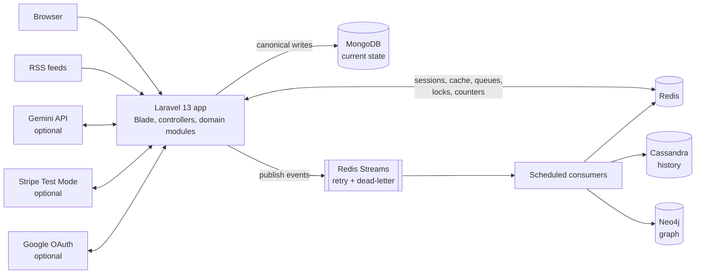

# VietFeed


**A Vietnamese news aggregator that presents multi-source coverage of the same event as a single "Story" page, with source-attributed evidence, a timeline, and an AI brief that is only published after human review.**

Live demo: coming soon.

VietFeed runs on four NoSQL stores (MongoDB, Cassandra, Neo4j, Redis) with no SQL database at runtime. Each store owns the data whose access pattern it fits, and cross-store data is projected asynchronously with retry, dead-letter and replay.

<!-- Screenshots: un-comment this section once docs/images/readme/*.png are added.
## Screenshots

| Home feed | Story page (StoryLens) |
|---|---|
|  |  |

| AI brief review (admin) | Admin RBAC |
|---|---|
|  |  |

| Account recovery |
|---|
|  |
-->

## Highlights

- **Polyglot persistence by workload, not by decoration.** MongoDB holds current state, Cassandra holds time-ordered history, Neo4j holds relationship projections, Redis holds sessions, cache, queues, Streams and counters.
- **Controlled eventual consistency.** MongoDB is the single authority for a write. Cassandra, Neo4j and Redis projections are derived through Redis Streams with bounded retry, a dead-letter stream, and replay. A failed projection never makes the canonical Article or Story unavailable.
- **AI is never on the critical path and never published unreviewed.** Story pages render canonical evidence without waiting for a model. A generated brief appears publicly only after human acceptance, otherwise an extractive brief built from the source excerpts is shown.
- **Fixed-permission RBAC with a Super Admin invariant.** Guarded by conditional writes in MongoDB so the last Super Admin cannot be removed, with an authorization audit trail.
- **Idempotent, checkpointed account purge.** Deletion revokes access immediately, keeps a recovery window (default 30 days), then purges across Mongo, Redis, Cassandra, Neo4j and Stripe, resuming at the first unfinished step after a failure.
- **First-party API tokens** (opaque access and refresh tokens, rotation, reuse detection) with state in Redis.
- **Tests run on isolated stores** (separate Mongo database, Cassandra keyspace and Redis DB) with a guard that fails any test touching a SQL connection. 593 tests at the last verified run.

## Architecture



### Data, store and why

Derived from [`docs/architecture/database-feature-map.md`](docs/architecture/database-feature-map.md).

| Data | Store | Why |
|---|---|---|
| Users, roles and permissions, categories, sources, articles, stories, comments, reports, sanctions, bookmarks, boosts, subscriptions | MongoDB | Current-state document CRUD with unique indexes and conditional single-document writes |
| Story evolution, reading and unlock history, source fetch history, interaction activity, moderation and authorization audit | Cassandra | Append-only, query-first tables partitioned by entity and time |
| Article, Story, Source, Entity and Aspect relationships | Neo4j | Multi-hop traversal for related stories and source coverage; rebuildable projection |
| Sessions, cache, queues, Streams, locks, trending sorted sets, Reading Pass quota counters, API token state | Redis | Ephemeral, low-latency state that can be rebuilt; never the only holder of business data |
| Subscriptions and webhook receipts | MongoDB (Stripe is the external authority) | Billing keeps no other database on its critical path |

Features only use an extra store when a concrete access pattern needs it (for example billing and category CRUD use only MongoDB).

## Features

**Reader**
- Home feed with load-more, category pages, search with live suggestions, article pages, and a trending ticker (`routes/web.php`).
- Bookmarks and boosts, comments and replies, onboarding interests, profile and preferences.
- Register, local login, Google OAuth login, email verification and password reset.

**StoryLens and AI brief**
- Story page renders canonical articles, sources and a basic timeline first; the Cassandra timeline, Neo4j graph and brief sections then load progressively with explicit `pending`, `ready`, `failed` and fallback states.
- Brief generation runs asynchronously behind a provider seam (`gemini`, `openai` (any OpenAI-compatible endpoint), offline `fake`, or `none`), with timeout, structured validation and evidence IDs.
- Editorial review: admins accept, reject or retry a brief. Public pages show a brief only after acceptance and only for the current Story version.

**Admin and RBAC**
- Fixed roles (`user`, `admin`, `super_admin`) and a fixed permission catalog, granted by a Super Admin. Admin areas: dashboard, processing/projection status with retry, sources and source health, categories, articles, comments, users, reports, sanctions, Story review, authorization audit.

**Moderation**
- User reports on comments, admin case review, sanctions and appeals. Review queue in Redis (rebuildable from MongoDB), audit history in Cassandra, with `moderation:repair` completing interrupted actions.

**Billing and Reading Pass**
- Stripe Checkout and Billing Portal in Test Mode, signed and idempotent webhooks, MongoDB subscription state. Reading Pass quota uses atomic Redis counters with Cassandra unlock history.

**API tokens**
- `/api/v1/auth/{login,refresh,logout,me}`, `stories/{story}` and `boosts/toggle` protected by short-lived access tokens and rotating refresh tokens.

**Account lifecycle**
- Self-service deletion with password, recovery during the retention window, admin-scheduled deletion and recovery, then scheduled purge.

## Engineering decisions and hard problems

**No transactions on standalone MongoDB.** The single-node deployment cannot use multi-document transactions, so state changes use conditional single-document writes, version fields and time-bounded leases (for example brief generation, moderation claims, Super Admin guard). Interrupted multi-step actions are converged by repair commands. See [`docs/database/nosql-local.md`](docs/database/nosql-local.md) (sections for Gates 9b, 9.6 and 9.7a; "Gate" = project milestone).

**Redis Streams to Cassandra and Neo4j projections.** Consumers use consumer groups, claim stale deliveries, retry after 1, 2, 4 and 8 seconds, and write a fifth failure to a dead-letter stream before acknowledging. Projections are idempotent and can be replayed or re-emitted from canonical state. Cross-store reads are explicitly not transactional. See [`docs/database/nosql-local.md`](docs/database/nosql-local.md) (Gate 5 and Gate 6 sections) and the [failure scenarios](docs/demo/failure-scenarios.md).

**Super Admin invariant under concurrency.** A single guard document in MongoDB is changed only by conditional updates with a generation and repair token, and `users.authorization_version` fences stale writes, so concurrent demotions cannot leave the system without a Super Admin. Permission checks read MongoDB, never a Redis cache. See [Gate 9.7a report](.agent/tasks/rbac/GATE-REPORT-9.7a.md).

**Idempotent, checkpointed account purge.** `accounts:purge` runs a fixed sequence of steps (Stripe, bookmarks, boosts, unlocks, comments, Redis, Cassandra anonymize and delete, Neo4j, user document), each safe to repeat, resuming from the first unfinished step. Comments are anonymized in place so other users' replies survive. See [Gate 9.7b report](.agent/tasks/account-lifecycle/GATE-REPORT-9.7b.md).

**AI brief only after human review, with extractive fallback.** `AI_BRIEF_REQUIRE_REVIEW` defaults to true. A Story version change invalidates a published brief immediately and fences older workers. If a model fails validation or is unavailable, the page shows an extractive brief from source excerpts. See [Gate 9.6 report](.agent/tasks/storylens-ai-brief/GATE-REPORT-9.6.md).

**Deterministic, labelled synthetic workload.** `demo:synthetic` seeds a versioned manifest (fixed seed, 16 readers, 48 events) over the frozen real-RSS fixture. Synthetic records carry `synthetic: true` and are excluded from public counts, dashboard totals and live trending. See [Gate 10.1 report](.agent/tasks/demo-readiness/GATE-REPORT-10.1.md).

## Testing and quality

- `composer run test` runs the PHPUnit suite (`Unit` and `Feature`). `phpunit.xml` forces isolated stores: MongoDB database `vietfeed_test`, Cassandra keyspace `vietfeed_test`, array cache and session, sync queue, and no AI provider or API keys. `Tests\TestCase` also fails any test that resolves a non-Mongo connection.
- Last verified result: **593 tests, 13,184 assertions, exit 0** (Gate 10.1 final run; see [the report](.agent/tasks/demo-readiness/GATE-REPORT-10.1.md)). The suite needs the four stores running.
- An opt-in integration suite under `tests/Integration` (`php artisan test tests/Integration`) exercises real driver and projection convergence; it passed 36/36 at Gate 10.1.
- Process: work was split into small milestones ("gates"), each with acceptance criteria, a gate report and code reviews (AI-model reviews plus owner sign-off), kept under [`.agent/tasks/`](.agent/tasks/). For example, [Gate 10.1](.agent/tasks/demo-readiness/GATE-REPORT-10.1.md) went through five reviews and three fix rounds.

## Getting started (local)

Prerequisites: PHP 8.3+ (tested on 8.4) with the `redis` extension and the MongoDB extension, Composer, Node.js and npm, Docker with Compose. The local store containers have memory limits totalling about 3.5 GB (`docker-compose.yml`).

```bash
composer install
cp .env.example .env            # then set MONGO_ROOT_USER/PASSWORD, NEO4J_USER/PASSWORD and REDIS_PASSWORD to the local dev defaults in docker-compose.yml; never commit real secrets
php artisan key:generate
docker compose up -d && ./scripts/nosql-health.sh --wait 120
npm install --ignore-scripts && npm run build
```

Prepare schemas and data (from [`docs/database/nosql-local.md`](docs/database/nosql-local.md), "Setup / clean reset"):

```bash
php artisan migrate --force                      # MongoDB index migrations
php artisan storylens schema                     # Cassandra Story timeline
php artisan interactions schema                  # Cassandra interaction activity
php artisan reading-pass schema                  # Cassandra Reading Pass history
php artisan moderation:audit schema              # Cassandra moderation audit
php artisan sources:history-manage bootstrap     # Cassandra source fetch history
php artisan rbac:audit schema                    # Cassandra authorization audit
php artisan db:seed --force                      # categories, sources, users, demo engagement
php artisan storylens ingest                     # frozen real-RSS StoryLens fixture
# db:seed creates the local admin account and makes it Super Admin via rbac:bootstrap (local credentials: see database/seeders/UserSeeder.php)
```

Run the app (keep exactly one `schedule:work` running; it drives the projection consumers):

```bash
php artisan serve
php artisan queue:listen --tries=1 --timeout=0
php artisan schedule:work
# or: composer run dev   (server, queue, logs, scheduler and Vite together)
```

Optional integrations, all off by default:

| Feature | Environment keys |
|---|---|
| AI brief (Gemini) | `AI_PROVIDER=gemini`, `GEMINI_API_KEY`. Use `AI_PROVIDER=fake` for an offline demo |
| Stripe Test Mode | `STRIPE_KEY`, `STRIPE_SECRET`, `STRIPE_PRO_PRICE_ID`, `STRIPE_WEBHOOK_SECRET` |
| Google OAuth | `GOOGLE_CLIENT_ID`, `GOOGLE_CLIENT_SECRET`, `GOOGLE_REDIRECT_URI` (read in `config/services.php`; not listed in `.env.example`) |

Live RSS ingestion is `php artisan feeds:fetch` (also scheduled every 30 minutes). Without keys the app still runs; AI generation is disabled and billing and Google login are unavailable. Full runbooks: [`docs/demo/runbook.md`](docs/demo/runbook.md).

## Project structure

```text
app/
  Accounts/        account deletion, recovery and purge
  ApiTokens/       first-party access/refresh token service (Redis, Lua)
  Authorization/   fixed permissions, Super Admin guard, authorization audit
  Billing/         Stripe gateway and webhook handling
  Console/         artisan commands (feeds, storylens, rbac, moderation, demo, ...)
  Content/         catalog, categories, article counts
  Demo/            deterministic synthetic workload
  Interaction/     bookmarks, boosts, activity events, trending
  Moderation/      reports, cases, sanctions, review queue, audit
  ReadingPass/     quota, unlock ledger, history
  StoryLens/       Story reads and AI brief (model, validator, store)
  StoryProcessing/ pipeline, Cassandra and Neo4j clients, timeline, graph
database/          Mongo index migrations and seeders
docs/
  specs/           canonical spec (vietfeed-nosql-storylens.md)
  architecture/    database feature map
  database/        local stack and per-gate operating notes
  demo/            runbook, failure scenarios, per-module demos
  planning/        technical gates
  evaluation/      human annotation guide
.agent/tasks/      gate reports and independent reviews
```

## Roadmap and status

Gates 1 to 9.7 and Gate 10.1 (demo wiring, scheduler, synthetic workload) are complete, as recorded in the gate reports under [`.agent/tasks/`](.agent/tasks/) (gate scope: [`docs/planning/technical-gates.md`](docs/planning/technical-gates.md)). Remaining in Gate 10:

- **Failure-fallback verification:** fallbacks for Gemini, Stripe, Google, a live RSS source or a projection outage are documented ([failure scenarios](docs/demo/failure-scenarios.md)) but not yet verified end to end (planned Gate 10.2).
- **Evaluation dataset:** the frozen real-RSS fixture currently holds 10 items with two manually assigned story keys; the larger annotated dataset, human reconciliation and AI claim review are not done (planned Gate 10.3). Stories are attached through this fixture; automatic clustering of live RSS items into Stories is not implemented.
- **Demo rehearsal:** the 15, 20 and 30 minute runbooks exist but have not been rehearsed from a clean reset (planned Gate 10.4).

The project targets local development and demo only: single-node containers, no production deployment or high-availability setup.

## Team and credits

Built by Nhóm 09, a course project for Môn Lập trình mã nguồn mở.
<!-- TODO owner: add names/roles -->

Development used AI coding assistants for implementation and code review, directed and reviewed by the team; final decisions and merges are human.

## License

License: not yet specified. (`composer.json` carries the default Laravel skeleton `MIT` field, but the repository has no `LICENSE` file.)
